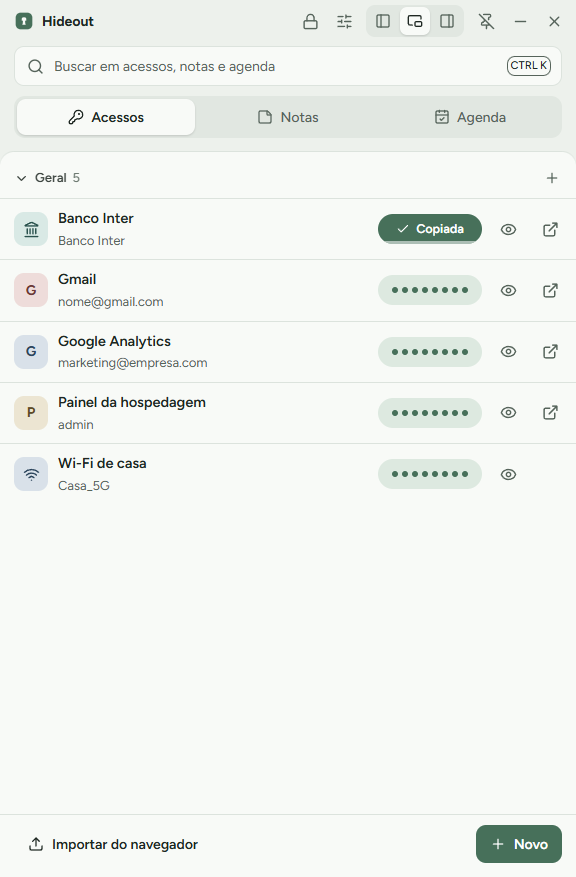
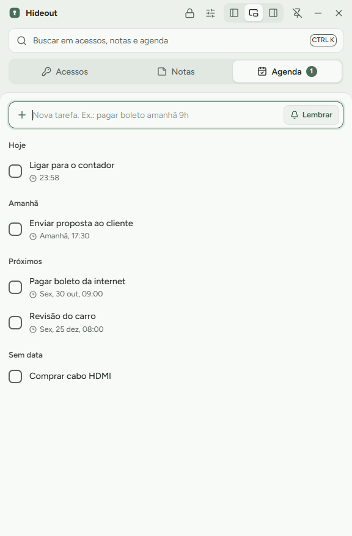

<p align="center">
  
</p>

<h1 align="center">Hideout</h1>

<p align="center">
  Senhas, notas e agenda num cofre criptografado que mora no canto da tela.<br>
  <a href="https://pbrmarcos.github.io/hideout/">Site</a> ·
  <a href="https://github.com/pbrmarcos/hideout/releases/latest">Baixar para Windows</a>
</p>

<p align="center">
  
  
</p>

## O que ele faz

- **Acessos**: sites, bancos, cartões, Wi-Fi (com QR Code), documentos e servidores, organizados por categoria. A senha fica oculta e **um clique copia**; 30 segundos depois ela sai da área de transferência, sem passar pelo histórico do Win+V nem pela nuvem.
- **Notas** com checklist (`- [ ]`), cores e anexos.
- **Agenda**: tarefas simples ou lembretes com notificação do Windows. Entende "pagar boleto amanhã 9h".
- **Janela de 30% da largura**, flutuante ou encaixada na esquerda/direita. `Ctrl+Alt+V` mostra e esconde de qualquer lugar.
- **Digitar login**: no campo de login de qualquer site, `Ctrl+Alt+A` digita usuário e senha.
- **Busca global** (`Ctrl+K`), importação do Chrome/Edge/Brave, gerador de senhas, lixeira de 30 dias, histórico de senhas, 8 temas.
- **Várias contas** no mesmo computador, cada uma com o próprio cofre.

## Segurança

| | |
|---|---|
| Arquivo do cofre | `OneDrive\Hideout-Dados\<usuario>.vault`, cifrado com AES-256-GCM |
| Senha mestra | Deriva a chave com scrypt (N=2¹⁷, r=8, p=1). Nunca é gravada |
| 2FA (TOTP) | Pedido ao entrar num computador novo |
| PIN de 6 dígitos | Só neste computador, protegido pelo DPAPI do Windows; 5 erros pedem a senha de novo |
| Código de recuperação | 24 caracteres, mostrado uma vez, para senha esquecida ou celular perdido |
| Rede | Nenhuma. Sem servidor, sem telemetria |

O 2FA funciona sem servidor: ele protege a entrada pelo app em computadores novos, mas quem tiver o arquivo **e** a senha mestra consegue abrir o cofre. Por isso a senha mestra precisa ser forte.

Se dois computadores alterarem o cofre ao mesmo tempo, o Hideout junta as mudanças item por item (a versão mais recente de cada item vence) e mantém os 5 últimos backups ao lado do arquivo.

## Instalar

Baixe o `Hideout-Setup-x.y.z.exe` (ou a versão portátil) em [Releases](https://github.com/pbrmarcos/hideout/releases/latest). O instalador ainda não tem assinatura digital, então o Windows pode mostrar "O Windows protegeu o computador": clique em **Mais informações → Executar assim mesmo**.

## Desenvolver

Requer Node.js 22 ou mais novo, no Windows.

```bash
npm install
npm run dev        # app em modo de desenvolvimento
npm test           # testes (criptografia, TOTP, fusão, CSV, datas)
npm run typecheck
npm run dist       # gera dist/Hideout-Setup-*.exe e dist/Hideout-Portable-*.exe
```

Para testar sem tocar no seu cofre real, defina `HIDEOUT_PROFILE` (pasta de dados do app) e `HIDEOUT_VAULT_DIR` (pasta dos cofres).

```
src/
  main/       processo principal: cofre, criptografia, janela, lembretes, área de transferência
  preload/    ponte segura entre a interface e o processo principal
  renderer/   interface (Vue 3 + Nuxt UI)
  shared/     tipos, modelos, temas e fusão de dados
docs/         site (GitHub Pages)
tests/        testes automatizados
```

Feito com Electron, Vue 3, Nuxt UI e Tailwind CSS.

## English

Hideout is a Windows side-panel app for passwords, notes and reminders. Everything lives in one AES-256-GCM encrypted file (in your OneDrive by default), unlocked by a master password, TOTP on new devices and a local 6-digit PIN. No servers, no telemetry. The interface is in Brazilian Portuguese. MIT licensed.

## Licença

[MIT](LICENSE)
