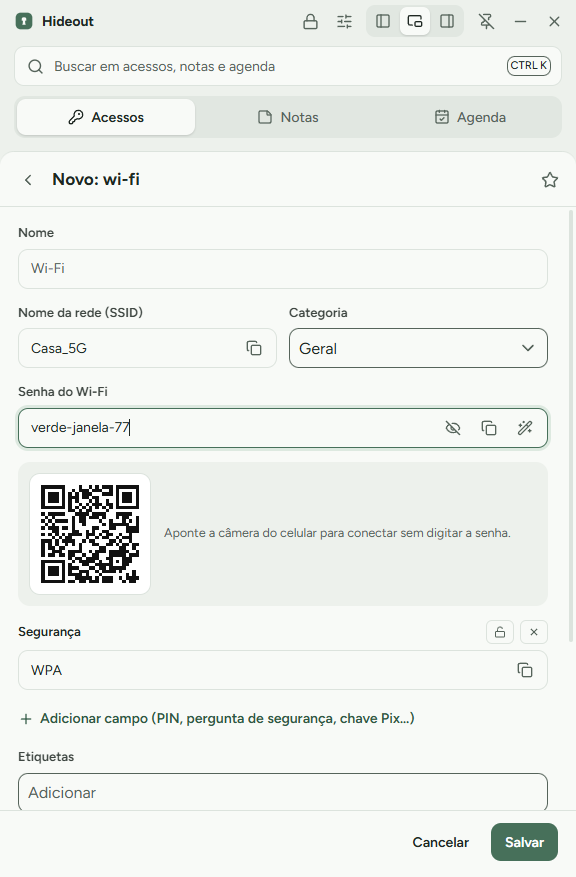

<p align="center">
  
</p>

<h1 align="center">Hideout</h1>

<p align="center">
  <b>Senhas, notas e agenda a um clique, num cofre que só você abre.</b><br>
  App para Windows que fica encaixado no canto da tela. Sem servidor, sem conta, código aberto.
</p>

<p align="center">
  <a href="https://github.com/pbrmarcos/hideout/releases/latest"></a>
  <a href="https://github.com/pbrmarcos/hideout/releases"></a>
  
  <a href="LICENSE"></a>
</p>

<p align="center">
  <a href="https://github.com/pbrmarcos/hideout/releases/latest/download/Hideout-Setup.exe"><b>Baixar para Windows</b></a> ·
  <a href="https://pbrmarcos.github.io/hideout/">Site</a> ·
  <a href="https://pbrmarcos.github.io/hideout/guia.html">Atalhos e ajustes</a> ·
  <a href="#english">English</a>
</p>

<p align="center">
  
  
  
</p>

## Por que o Hideout?

- **Suas senhas só se abrem no seu computador.** O cofre é um arquivo criptografado (AES-256-GCM). Não existe servidor do Hideout, conta online nem telemetria. Se o arquivo estiver no OneDrive, a nuvem só guarda bytes embaralhados.
- **Fica do lado do que você está fazendo.** A janela ocupa 30% da largura, encaixa na esquerda ou na direita, e um clique na senha copia. Ela some da área de transferência sozinha e não entra no histórico do Win+V.
- **Um lugar só para o que você vive procurando.** Logins e links, Wi-Fi, cartões, documentos, notas com checklist e lembretes com notificação do Windows.

## Começar em 2 minutos

1. Baixe o [**Hideout-Setup.exe**](https://github.com/pbrmarcos/hideout/releases/latest/download/Hideout-Setup.exe) (ou a [versão portátil](https://github.com/pbrmarcos/hideout/releases/latest/download/Hideout-Portable.exe), que roda sem instalar).
2. Se aparecer **"O Windows protegeu o computador"**, clique em **Mais informações** e depois em **Executar assim mesmo**. O aviso aparece porque o instalador ainda não tem certificado de assinatura, que é pago.
3. Crie sua conta: usuário e senha mestra (mínimo de 12 caracteres; quatro palavras soltas funcionam bem).
4. Escaneie o QR Code com um app autenticador (Google Authenticator, Microsoft Authenticator ou Authy) e digite o código.
5. Crie um PIN de 6 dígitos para o dia a dia.
6. **Guarde o código de recuperação** longe do computador. É a única forma de voltar ao cofre se esquecer a senha ou perder o celular.

Pronto: o cofre fica em `OneDrive\Hideout-Dados\<usuario>.vault` e, no dia a dia, só o PIN abre o app.

## Recursos

| | |
|---|---|
| **Acessos** | Modelos de login, cartão, Wi-Fi (com QR Code), documento, conta bancária e servidor. Categorias, favoritos, etiquetas, campos extras, gerador de senhas e histórico das senhas antigas |
| **Copiar com um clique** | A senha sai da área de transferência depois de 30 segundos (ajustável) e é marcada para não ir ao histórico do Win+V nem à nuvem |
| **Digitar login** | No campo de login de qualquer site ou programa, `Ctrl+Alt+A` digita usuário, Tab, senha e Enter |
| **Notas** | Checklist com `- [ ]`, cores, fixar no topo e anexos criptografados (até 10 MB cada) |
| **Agenda** | Tarefas simples ou lembretes com notificação do Windows. Entende "pagar boleto amanhã 9h", "sexta 10h" e "25/12 8h" |
| **Janela** | 30% da largura, flutuante ou encaixada nas laterais, sempre no topo opcional, ícone na bandeja e abertura junto com o Windows |
| **Importar** | Senhas exportadas do Chrome, Edge ou Brave (CSV) |
| **Mais** | Busca global, lixeira de 30 dias, backup criptografado, várias contas no mesmo PC e 8 temas (Sálvia, Lavanda, Areia, Névoa, Noite, Oceano, Rubi e Matrix) |

## Atalhos

| Atalho | O que faz |
|---|---|
| `Ctrl+Alt+V` | Mostra ou esconde o Hideout de qualquer lugar |
| `Ctrl+Alt+A` | Digita o login no campo onde está o cursor |
| `Ctrl+K` | Busca em acessos, notas e agenda (`Enter` copia a senha) |
| `Ctrl+1` `Ctrl+2` `Ctrl+3` | Troca entre Acessos, Notas e Agenda |
| `Ctrl+N` | Cria um item novo |
| `Esc` | Fecha o painel aberto |

Todos os atalhos e cada opção das Configurações, com animações, estão em [Atalhos e ajustes](https://pbrmarcos.github.io/hideout/guia.html).

## Segurança

| | |
|---|---|
| Arquivo do cofre | AES-256-GCM no arquivo inteiro, com cada parte presa ao cofre e ao campo a que pertence |
| Senha mestra | Vira a chave por scrypt (N=2¹⁷, r=8, p=1). Nunca é gravada |
| 2FA (TOTP) | Pedido ao entrar num computador novo |
| PIN de 6 dígitos | Só no computador onde foi criado, protegido pelo DPAPI do Windows. Cinco erros pedem a senha mestra |
| Código de recuperação | 24 caracteres, mostrado uma única vez |
| Rede | Nenhuma conexão. Sem servidor e sem telemetria |
| Sincronização | Se dois PCs mudarem o cofre ao mesmo tempo, as alterações são juntadas item por item. Os 5 últimos backups ficam ao lado do arquivo |

**Limites que você precisa conhecer:**

- Sem servidor, o 2FA protege a entrada pelo app em computadores novos. Quem tiver o arquivo **e** a sua senha mestra consegue abrir o cofre. Use uma senha mestra forte.
- Sem a senha mestra e sem o código de recuperação, ninguém recupera o cofre, nem quem fez o app.
- O Hideout ainda não passou por auditoria de segurança independente. A criptografia está em [`src/main/crypto.ts`](src/main/crypto.ts) para quem quiser conferir.

Achou uma falha? Veja [SECURITY.md](SECURITY.md) para relatar de forma privada.

## Status

Primeira versão (0.1.x), recém-lançada. Por ser nova, mantenha o código de recuperação guardado e, de vez em quando, use **Configurações → Exportar backup criptografado**. A interface está em português; o site também está em inglês e espanhol.

## Desenvolver

Requer Windows e Node.js 22 ou mais novo.

```bash
git clone https://github.com/pbrmarcos/hideout
cd hideout
npm install
npm run dev
```

O app abre em modo de desenvolvimento. Para testar sem tocar no seu cofre real, use pastas separadas:

```powershell
$env:HIDEOUT_PROFILE = "$env:TEMP\hideout-dev\perfil"
$env:HIDEOUT_VAULT_DIR = "$env:TEMP\hideout-dev\cofres"
npm run dev
```

| Comando | O que faz |
|---|---|
| `npm test` | Testes de criptografia (incluindo o vetor oficial do TOTP), fusão de dados, importação de CSV e datas |
| `npm run typecheck` | Checagem de tipos do processo principal |
| `npm run dist` | Gera `dist/Hideout-Setup.exe` e `dist/Hideout-Portable.exe` |
| `npm run site` | Gera o site em `docs/`, `docs/en/` e `docs/es/` a partir de `site/` |
| `npm run icons` | Redesenha os ícones a partir do código |

```
src/
  main/       processo principal: cofre, criptografia, janela, lembretes, área de transferência
  preload/    ponte segura entre a interface e o processo principal
  renderer/   interface (Vue 3 + Nuxt UI)
  shared/     tipos, modelos, temas e fusão de dados
site/         modelos e textos do site (pt, en, es)
docs/         site gerado para o GitHub Pages
tests/        testes automatizados
```

Feito com Electron, Vue 3, Nuxt UI e Tailwind CSS.

## Contribuir

Toda ajuda é bem-vinda, de um relato de erro a uma tradução.

- **Achou um erro?** [Abra uma issue](https://github.com/pbrmarcos/hideout/issues/new) dizendo o que fez, o que esperava e o que aconteceu.
- **Tem uma ideia?** Conte em [Discussions](https://github.com/pbrmarcos/hideout/discussions/categories/ideas).
- **Quer mandar código?** Veja o [CONTRIBUTING.md](CONTRIBUTING.md).

## English

> **Passwords, notes and reminders one click away, in a vault only you can open.**

Hideout is a free, open source Windows app that docks at the edge of your screen (30% of its width, left, right or floating). It keeps logins, Wi-Fi, cards, documents, notes and reminders in a single AES-256-GCM encrypted file, unlocked by a master password, TOTP on new computers and a local 6-digit PIN. There is no server, no account and no telemetry; if the file lives in OneDrive, the cloud only stores scrambled bytes. One click copies a password, which is cleared from the clipboard after 30 seconds and kept out of Win+V history.

[**Download for Windows**](https://github.com/pbrmarcos/hideout/releases/latest/download/Hideout-Setup.exe) · [Website](https://pbrmarcos.github.io/hideout/en/) · [Shortcuts and settings](https://pbrmarcos.github.io/hideout/en/guia.html)

The app interface is in Brazilian Portuguese for now. The installer is not code-signed yet, so Windows may show a warning: click **More info**, then **Run anyway**. Hideout has not had an independent security audit.

## Licença

[MIT](LICENSE). Use, modifique e distribua à vontade, mantendo o aviso de copyright.
